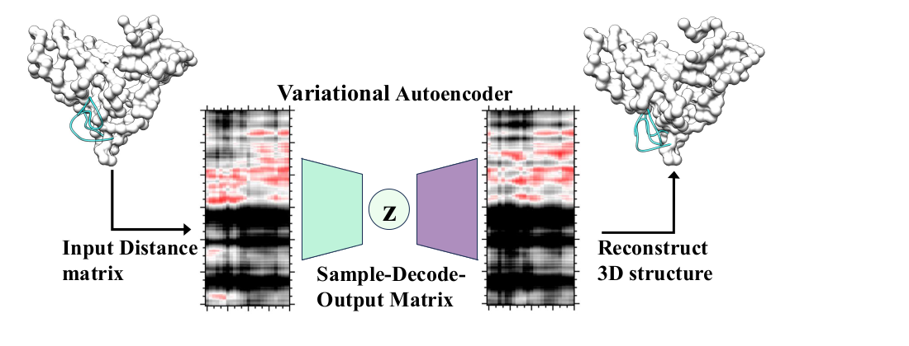

# Learning the Polymer–Protein Adsorption Landscape via Physics-Informed Generative Modeling



This repository contains the data, source code, trained model, and representative generated samples associated with the manuscript **“Learning the Polymer–Protein Adsorption Landscape via Physics-Informed Generative Modeling.”**

## Overview

Polymer–protein adsorption involves a large conformational space arising from polymer flexibility and heterogeneous protein surfaces. This work develops a physics-informed generative framework based on a variational autoencoder (VAE) to learn polymer–protein adsorption landscapes from molecular-dynamics (MD) data and efficiently generate diverse adsorption configurations.

Each complex is represented by a polymer–protein intermolecular distance matrix. A structure-aware dual-axis encoder combines graph convolution along the protein-residue axis with one-dimensional convolution along the polymer-chain axis. The model further uses an interface-aware reconstruction loss and energy-based sample weighting to emphasize short-range contacts and physically favorable configurations. Generated distance matrices can subsequently be converted into three-dimensional structures using the physics-constrained reconstruction procedure described in the manuscript.

The example system is adsorption of a 25-monomer NIPAm/TBAm/AAc copolymer on epithelial cell adhesion molecule (EpCAM; PDB ID: 4MZV). The model uses an 8-dimensional latent space and represents each configuration as a 25 × 241 matrix of monomer–residue center-of-mass distances.

## Repository structure

```text
.
├── model.py                         # VAE architecture and loss functions
├── train.py                         # Training, validation, and sample generation
├── training_samples/                # Training samples
│   ├── dis_matrix.dat_*             # 339 MD-derived distance matrices
│   └── Sample_Weights/               # Energy-based sample weights
│       └── edr_dis_matrix_*.dat      # 339 weight/energy files
├── processed/
│   ├── protein_adj_norm.pt          # Normalized EpCAM residue adjacency matrix
│   ├── vae_best.pt                  # Trained model checkpoint
│   └── empirical_mu.pt              # Empirical latent means from training data
└── generated/
    └── empirical_*.dat              # Ten representative generated matrices
```

## Requirements

- Python 3
- [PyTorch](https://pytorch.org/)
- NumPy

Create and activate a Python environment, then install the required packages:

```bash
python -m venv .venv
```

On Linux or macOS:

```bash
source .venv/bin/activate
pip install numpy torch
```

On Windows PowerShell:

```powershell
.venv\Scripts\Activate.ps1
pip install numpy torch
```

PyTorch automatically uses a CUDA-capable GPU when a compatible CUDA build is installed; otherwise, the scripts run on the CPU.

## Data format

### Distance matrices

Each `dis_matrix.dat_*` file contains one 25 × 241 polymer–protein distance matrix in nanometers:

- rows correspond to the 25 copolymer monomers;
- columns correspond to the 241 EpCAM residues;
- each stored row contains a leading row index followed by 241 distance values.

The generated files in `generated/` use the same layout.

### Energy-based sample weights

Each file in `training_samples/Sample_Weights/` corresponds to one distance matrix and records the Lennard–Jones, Coulomb, and contact contributions used to calculate its training weight. The `weight=` field is read by the training workflow.

## Usage

### Training and generation

Run the complete training and generation workflow from the repository root:

```bash
python train.py
```

The workflow:

1. loads the 339 distance matrices and their energy-based weights;
2. performs a reproducible 80:20 training/validation split using random seed 42;
3. trains the VAE with KL warm-up, learning-rate scheduling, gradient clipping, and early stopping;
4. saves the best checkpoint to `processed/vae_best.pt`;
5. constructs the empirical latent distribution and saves it to `processed/empirical_mu.pt`;
6. generates representative distance matrices in `generated/`; and
7. reports reconstruction MSE, MAE, and correlation on validation examples.

The deposited `processed/vae_best.pt` checkpoint and `generated/empirical_*.dat` files allow inspection of the trained model and representative outputs without retraining. The ten generated matrices in this repository are examples; the larger generated ensembles analyzed in the manuscript were produced using the same workflow.

## Method summary

1. Diverse adsorption configurations were sampled using Martini coarse-grained MD simulations of the EpCAM–copolymer system.
2. Each configuration was converted into a 25 × 241 monomer–residue distance matrix.
3. Protein-surface correlations were learned using graph convolution, while polymer-chain correlations were learned using one-dimensional convolution.
4. An interface-aware loss emphasized short polymer–protein distances, and energy-based weights favored physically stable configurations while retaining structural diversity.
5. New matrices were sampled from the learned empirical latent distribution.
6. Three-dimensional polymer–protein complexes were reconstructed using polymer connectivity, local geometry, and excluded-volume constraints, as detailed in the manuscript.

## Data and code availability

The source code, MD-derived training matrices, energy-based sample weights, trained model, empirical latent representation, and representative generated matrices supporting this study are publicly available in this repository.

Repository URL: <https://github.com/njustMD/Polymer-Protein-Adsorption>

## Citation

If you use this repository, please cite the associated manuscript:

> Ning, H.; Wu, N.; Jia, X.; Xu, X. *Learning the Polymer–Protein Adsorption Landscape via Physics-Informed Generative Modeling*. Manuscript submitted for publication.

The citation will be updated with journal, year, volume, pages, and DOI after publication.

## Contact

For questions about the work, please contact:

- Xu Jia: jiaxu@njust.edu.cn
- Xiao Xu: xuxiao@njust.edu.cn

School of Chemistry and Chemical Engineering, Nanjing University of Science and Technology, Nanjing 210094, P. R. China.

## License

No open-source license has been assigned. Copyright remains with the authors. Please contact the corresponding authors regarding reuse beyond inspection and academic evaluation.
